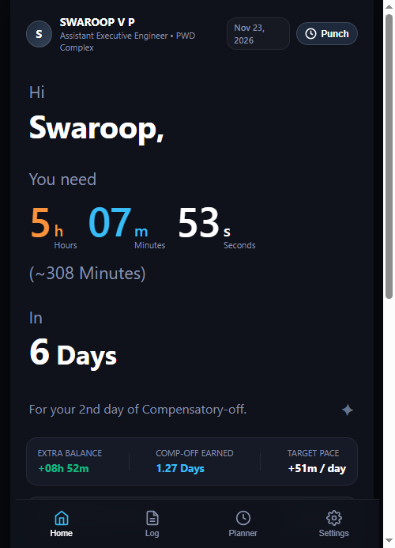

# Compensatory Off Tracker & Time Planner
> **Ultra-Minimalist Office Attendance & Compensatory Off (Comp-Off) Welcome Screen**

A sleek, mobile-first web app with a distraction-free, typography-driven welcome screen that instantly shows:
- **How many hours, minutes, and seconds you need** to unlock your next Comp-Off day
- **Total minutes equivalent** (~XXX Minutes)
- **Remaining working days** in the month (In X Days, excluding Sundays, 2nd/4th Saturdays, and Government Holidays)
- **Target milestone indicator** with minimal status pill
- **Official SPARK Attendance Import**: One-click import for SPARK digital attendance PDFs, screenshots with OCR, Excel/CSV, and clipboard paste
- **Accurate Overtime Tracking**: Only positive overtime minutes count toward the 10-hour milestone; single-punch days and non-working days are automatically handled

Built with clean **Vanilla HTML5, CSS3, and JavaScript** with **zero build step**, 100% client-side persistence via localStorage, and pre-configured for direct deployment to **GitHub Pages**.

---

## 🌟 Visual Preview

---

## 🎨 Minimalist Hero Screen Elements
- **Hi Swaroop,**
- **You need**:
  - Orange: Hours (h Hours)
  - Cyan: Minutes (m Minutes)
  - White: Seconds (s Seconds)
- **Total Minutes Equivalent**: (~XXX Minutes)
- **In [X] Days**: Accurate working day countdown excluding government non-working days
- **For a day of Compensatory-off**
- **Sleek Attendance Log**: Tabular view with one-click **Upload** (SPARK PDF/Image) and **Add** (manual punch)

---

## 🚀 Deployment to GitHub Pages (swaroopvp)

Live URL:
`
https://swaroopvp.github.io/C-Off_Tracker/
`

Repository:
`
https://github.com/swaroopvp/C-Off_Tracker.git
`
